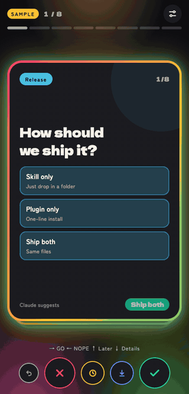
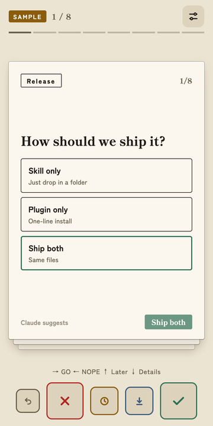
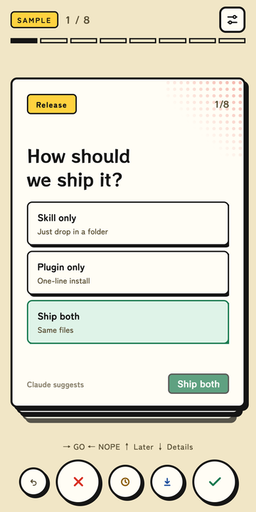
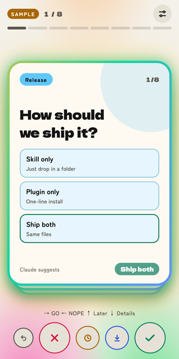
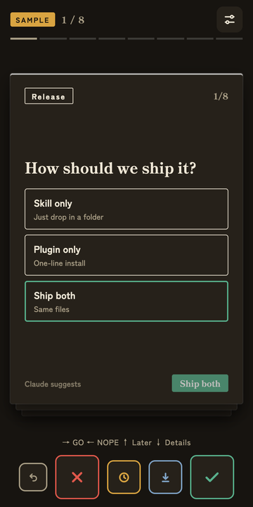
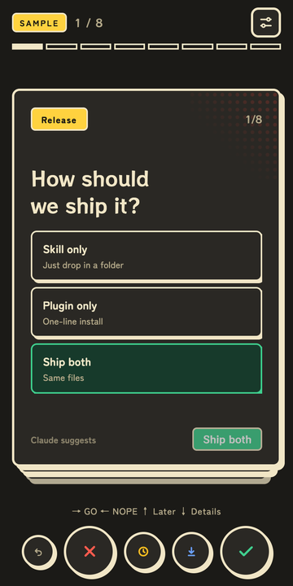
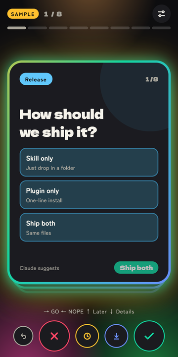

<div align="center">

# 🃏 swipe-decide

**ドパガキ向け。未決事項を、スワイプでサクサク片付ける。**

セッションに溜まった質問をカードにして、右=GO、左=NOPE でスワイプ。<br>
結果はClaudeがそのまま読んで、作業を再開します。

[English](README.md) · **日本語**

[](LICENSE)
[](#-30秒で始める)
[](https://github.com/masukai/swipe-decide/actions/workflows/check.yml)



[始め方](#-30秒で始める) · [操作](#-操作) · [見た目](#-見た目) · [コントリビュート](#-コントリビュート)

</div>

> 詳しい説明は英語版([README.md](README.md))を正とします。

## 💭 作った理由

Claude(Opus 5.5)が賢くなって、判断を求められる内容が「はい」と答えるだけのことも増えました。「はい」を何度も打つのが面倒で、質問をカードにしました。スワイプなら数秒で終わるし、正直ちょっとクセになります。仕事も趣味も楽しくなりました。

## ✨ こんなときに

- **セッションの途中で溜まったとき。** 5件の質問を1件ずつ答えず、まとめてスワイプ。
- **夜間や外出中にまとめて作業させたあと。** 迷った点を、朝にまとめて片付けられます。
- **確認をまとめたいとき。** 小さな判断を溜めておいて、空いた時間にスマホからでも一気に決められます。

## 🚀 30秒で始める

```bash
claude plugin marketplace add masukai/swipe-decide
claude plugin install swipe-decide@swipe-decide-marketplace
```

`/swipe-decide:swipe-decide` を実行するか、「未決事項をサクサク決めたい」と話しかければOKです。

スキル単体で使う場合は、`skills/swipe-decide/` を `~/.claude/skills/` にコピーして `/swipe-decide` を実行します。

## 👆 操作

| 動き | 決定 | PCでは |
|:---:|:---:|:---:|
| ➡️ 右 | **GO** | `→` |
| ⬅️ 左 | **NOPE** | `←` |
| ⬆️ 上 | **あとで** | `↑` |
| ⬇️ 下 | **詳しく** | `↓` |

選択カードは、選択肢をタップ(または数字キー)で決めます。右スワイプでClaudeのおすすめを採用します。

## 🎨 見た目

3つのスタイルに、それぞれライトとダーク。最初に選ぶか、おまかせにできます。

<table>
  <tr>
    <th align="center">calm</th>
    <th align="center">pop</th>
    <th align="center">flashy</th>
  </tr>
  <tr>
    <td align="center"></td>
    <td align="center"></td>
    <td align="center"></td>
  </tr>
  <tr>
    <td align="center"></td>
    <td align="center"></td>
    <td align="center"></td>
  </tr>
  <tr>
    <td align="center"><sub>和紙に朱印</sub></td>
    <td align="center"><sub>レトロ印刷風</sub></td>
    <td align="center"><sub>ネオン全開</sub></td>
  </tr>
</table>

## 🃏 カードの種類

Yes・No / 2〜4択 / 取り消しにくい判断の確認 / NOのときの代案。

## ❓ メモ

Claude Codeでのみテスト済みです。結果の保存は、Claude Codeなどシェルが使える環境では、Claudeが小さなローカルサーバー(自分のPC内だけ)を立てて自動で行います。Claudeアプリではアーティファクトが保存します。**スマホでスワイプするときは、Claudeアプリ(アーティファクトとして開きます)を使ってください。ローカルサーバーは自分のPCからしか開けません。**それ以外は「結果をコピー」してチャットへ貼り付けます。

## 🤝 コントリビュート

機能の要望やバグ報告はissueで、PRも歓迎です。詳しくは [CONTRIBUTING.md](CONTRIBUTING.md) へ。

**デザインに興味がある方、ぜひ。** カードUIは1つのHTMLファイルで、見た目(calm / pop / flashy)はそれぞれCSSのひとまとまりです。新しいスタイル、既存スタイルの磨き込み、どちらも大歓迎です。

## 🌱 このプロジェクトについて

趣味で作っています。改善したくなったときに更新します。要望はissueでどうぞ(返事の時期は約束できません)。スターはお好みでどうぞ。

## 📄 ライセンス

[MIT](LICENSE)
