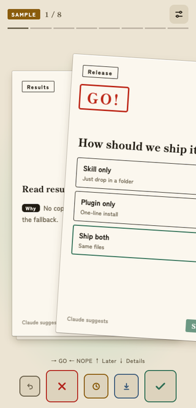
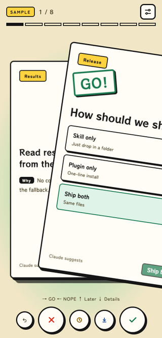
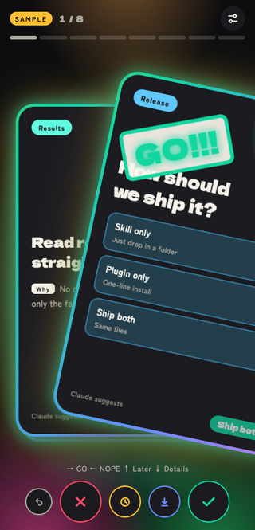

# swipe-decide

Decide like a dopamine goblin: swipe through your open decisions. ✨

A Claude skill that turns the open decisions piling up in your session into cards. Swipe right for GO, left for NOPE, and Claude picks the work back up with your answers.

[日本語](README.ja.md)


  

## Why I made it

Claude (Opus 5.5) has gotten smart enough that a lot of what it asks me now is just "yes, go ahead". Settling those with a swipe, and having a bit of fun doing it, makes work and hobby projects feel more enjoyable.

## 30-second start

```bash
claude plugin marketplace add masukai/swipe-decide
claude plugin install swipe-decide@swipe-decide-marketplace
```

Then run `/swipe-decide:swipe-decide`, or simply say “let’s decide these quickly.”

Want it as a plain skill instead? Copy `skills/swipe-decide/` into `~/.claude/skills/` and run `/swipe-decide`.

## Swipe your answer

| Move | Decision | On a PC |
|---|---|---|
| Right | **GO** | Right arrow |
| Left | **NOPE** | Left arrow |
| Up | **Later** | Up arrow |
| Down | **Details** | Down arrow |

## Three looks

- **Calm** — ink seal on washi paper
- **Pop** — cheerful retro print
- **Flashy** — full neon energy

Each look works in light or dark mode.

## Card types

- **Yes / No** — make a clean call
- **Choice** — pick one of 2–4 options
- **Risk** — get one extra check before a hard-to-undo GO
- **Fallback** — choose what happens instead after a NO

## How it works

1. Ask Claude to sort out the open decisions.
2. Pick a look and color mode once.
3. Claude turns up to 12 decisions into swipeable cards.
4. Swipe through, say “done,” and Claude continues with your choices.

## Quick notes

**Does this work outside Claude Code?**

The skill is plain `SKILL.md` plus one HTML file, but only Claude Code has been tested.

**Where do my results go?**

Outside the Claude app there is no automatic saving. Open the generated `decide.html`, use **Copy results**, and paste the result back into chat.

## About this project

This is a hobby project, updated when inspiration strikes. Issues are welcome, though I can’t promise a response time. Starring is entirely optional.

## License

MIT
